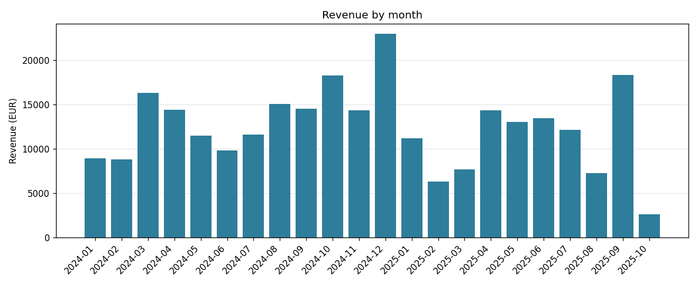

# Sales ETL Pipeline

Turns messy CSV exports into a trustworthy sales report, through PostgreSQL.

[](https://github.com/AymanMady/sales-etl-pipeline/actions/workflows/ci.yml)
[](https://www.python.org/)
[](https://www.postgresql.org/)
[](LICENSE)

```
  Raw CSV          Python              PostgreSQL         SQL          Report
  (messy)      extract / clean      staging + core     6 views     Markdown + CSV
                  transform         PK · FK · CHECK                   + chart
```



Every run rebuilds [reports/report.md](reports/report.md) from scratch and
verifies itself before publishing: row counts per table, zero orphan rows. A
failed check exits non-zero, so a broken pipeline fails the build instead of
quietly shipping a wrong number.

## Quick start

```bash
make install   # virtualenv + dependencies
make up        # start PostgreSQL (Docker)
make data      # generate the raw CSV files
make run       # run the pipeline
```

The report lands in [reports/report.md](reports/report.md).

## How it works

| Step | File | What it does |
|---|---|---|
| 0 | [sql/01_schema.sql](sql/01_schema.sql) | Creates the schemas, tables, keys and constraints |
| 1 · Extract | [src/extract.py](src/extract.py) | Reads the CSVs as plain text, interpreting nothing |
| 2 · Clean | [src/clean.py](src/clean.py) | Duplicates, dates, amounts, casing, impossible values |
| 3 · Transform | [src/transform.py](src/transform.py) | Splits the flat file into real tables, drops orphans |
| 4 · Load | [src/load.py](src/load.py) | Loads `staging` then `core`, parents before children |
| 5 · Analytics | [sql/02_analytics.sql](sql/02_analytics.sql) | Creates the views holding the business logic |
| 6 · Report | [src/report.py](src/report.py) | Queries the views and formats the output |

[src/pipeline.py](src/pipeline.py) runs the whole thing.

**Why read the CSVs as text?** Letting pandas guess the types turns `"00123"`
into `123` and drops whatever it cannot parse — losing information before you
get to decide what to do with it. Read first, clean second.

**Why two schemas?** `staging` keeps an exact copy of the CSVs with no
constraints, so you can trace any surprising number back to its source.
`core` holds only clean data, and enforces it.

## Data model

```
  core.customers                    core.products
  ───────────────                   ───────────────
  customer_id PK ◄──┐               product_id PK ◄──┐
  first_name        │               product_name     │
  last_name         │               category         │
  email UNIQUE      │               unit_price > 0   │
  city, country     │                                │
  signup_date       │                                │
                    │                                │
  core.orders       │               core.order_items │
  ───────────────   │               ───────────────  │
  order_id PK ◄─────┼──────┐        order_item_id PK │
  customer_id FK ───┘      └─────── order_id FK      │
  order_date                        product_id FK ───┘
  status (5 values)                 quantity > 0
                                    unit_price > 0
                                    line_total ← computed by PostgreSQL
```

`orders.csv` is flat: one row per product, with the customer and date repeated
on every row. If two rows of the same order disagree on the date, which is
true? So the pipeline splits it into `orders` (the order) and `order_items`
(its lines).

Three guardrails live in the schema:

- **`REFERENCES`** — an order cannot point at a customer who does not exist
- **`CHECK`** — a negative price or zero quantity never reaches the database
- **`GENERATED ALWAYS AS`** — `line_total` is computed by PostgreSQL, so it
  cannot drift from `quantity × unit_price`

## What it computes

All defined in [sql/02_analytics.sql](sql/02_analytics.sql):

| View | Contents |
|---|---|
| `core.v_kpi` | Revenue, order count, average order value |
| `core.v_sales_by_product` | Revenue and quantity per product, plus share of total |
| `core.v_sales_by_month` | Monthly revenue and growth vs previous month (`LAG`) |
| `core.v_top_customers` | Customers ranked by spend (`RANK`) |
| `core.v_sales_by_category` | Totals per product category |
| `core.v_sales` | Base view the others build on |

Two business rules, written once:

1. **Cancelled and returned orders earn no revenue.**
2. **Average order value = revenue ÷ distinct orders**, not the average order
   line. An order with three products is still one order.

Revenue is defined in SQL and nowhere else. Python only formats it.

## Data cleaning

[scripts/generate_raw_data.py](scripts/generate_raw_data.py) injects realistic
defects on purpose — without them the cleaning step would have nothing to do.

| Defect | What the pipeline does |
|---|---|
| Duplicate rows | Dropped |
| UPPERCASE emails | Lowercased *before* deduplicating |
| Missing or invalid email | Row dropped (email is the business key) |
| Same `customer_id` twice | Keeps the most recent |
| Missing country | Set to `Unknown`, row kept |
| Three date formats | Each format tried in turn |
| Unreadable date | Row dropped |
| `"89,90 EUR"` | Parsed to `89.90` |
| Negative or zero price | Product rejected |
| Zero or negative quantity | Row dropped |
| Missing price on an order | Filled from the product catalogue |
| Order from an unknown customer | Row dropped before loading |

Two principles:

- **Nothing is dropped silently.** Every rule counts its rows, and the totals
  appear in the report's *Data quality* section.
- **Filtering happens in Python, not in the database.** PostgreSQL would reject
  the whole batch over one orphan row, taking the thousand valid rows with it.

The pipeline also checks itself after loading: row counts per table and no
orphan rows. A pipeline that never checks itself will eventually produce a
wrong report without saying a word.

## Testing and CI

```bash
make test   # 31 unit tests, no database needed
make lint   # ruff: style, imports, likely bugs
```

The tests run against hand-built DataFrames, which is possible because
`clean.py` and `transform.py` are pure functions — DataFrame in, DataFrame out.

[GitHub Actions](.github/workflows/ci.yml) runs two jobs on every push:

1. **Lint and unit tests** — ruff plus the full pytest suite.
2. **End-to-end pipeline** — spins up a real PostgreSQL 16 service, generates
   the CSVs, runs the pipeline and uploads the report as a build artifact.
   The self-checks make this a genuine pass/fail, not a smoke test.

## Layout

```
sales-etl-pipeline/
├── .github/workflows/     CI: lint, tests, end-to-end run
├── docker-compose.yml     PostgreSQL 16 + Adminer
├── Makefile               shortcuts (make help)
├── pyproject.toml         pytest and ruff configuration
├── .env.example           config template (copy to .env)
├── data/raw/              generated CSVs
├── sql/
│   ├── 01_schema.sql      tables, keys, constraints
│   ├── 02_analytics.sql   the analysis views
│   └── 03_exercises.sql   SQL practice
├── src/                   the pipeline, one file per step
├── scripts/               raw data generator
├── tests/                 31 tests, no database needed
└── reports/               pipeline output
```

## Commands

```bash
make help      # list every command
make run       # full pipeline
make report    # rebuild the report without reloading the CSVs
make test      # unit tests
make lint      # style checks
make psql      # SQL console
make reset     # wipe the database and start over
```

Adminer runs at <http://localhost:8081> — server `postgres`, user `sales`,
password `sales`, database `sales`.

## Practice

[sql/03_exercises.sql](sql/03_exercises.sql) goes from plain `SELECT` to window
functions. Write your query before reading the solution below it. The last
exercise is three `INSERT` statements that **must** fail — proof the
constraints protect the data.

## Troubleshooting

**PostgreSQL unreachable** — `docker compose ps`, then `make up`.

**Port already in use** — the project uses `5433` (not `5432`) to avoid
clashing with a local PostgreSQL. Change `POSTGRES_PORT` or `ADMINER_PORT`
in `.env` if needed.

**`.csv not found`** — run `make data` first.

**Start from scratch** — `make reset && make data && make run`.

## What this project covers

- **ETL** — separate, testable steps instead of one long script
- **Data cleaning** — deciding per defect whether to fix, fill or drop, and
  recording the choice
- **Relational databases** — primary keys, foreign keys, `CHECK` constraints,
  normalisation, indexes on join columns
- **SQL** — joins, `GROUP BY`, CTEs, window functions, views
- **Docker** — a disposable database that behaves the same everywhere
- **CI** — every push linted, tested and run end to end against a real database

### Going further

- Add an API as a second source
- Load incrementally instead of reloading everything
- Add a date dimension and model a proper star schema
- Orchestrate with Airflow or Dagster
- Version the transformations with dbt

## License

[MIT](LICENSE) — Bechir Mady
