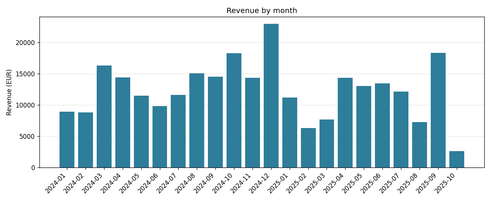

# Sales report

_Generated on 16 September 2026 at 14:04 by the ETL pipeline._
_Covering 02 Jan 2024 to 02 Oct 2025._

## Key figures

| Metric | Value |
|---|---|
| Revenue | **272,734.11 EUR** |
| Orders | **446** |
| Average order value | **611.51 EUR** |
| Active customers | 43 |
| Items sold | 1,738 |

> Average order value is revenue divided by distinct orders, not the
> average order line. Cancelled and returned orders are excluded.

## Revenue by month

| Month   |   Revenue (EUR) |   Orders |   Avg order (EUR) |   Growth (%) |
|:--------|----------------:|---------:|------------------:|-------------:|
| 2024-01 |        8,924.25 |       18 |            495.79 |         -    |
| 2024-02 |        8,780.53 |       20 |            439.03 |        -1.60 |
| 2024-03 |       16,277.11 |       23 |            707.70 |        85.40 |
| 2024-04 |       14,399.79 |       20 |            719.99 |       -11.50 |
| 2024-05 |       11,506.46 |       15 |            767.10 |       -20.10 |
| 2024-06 |        9,829.33 |       18 |            546.07 |       -14.60 |
| 2024-07 |       11,569.45 |       21 |            550.93 |        17.70 |
| 2024-08 |       15,061.90 |       18 |            836.77 |        30.20 |
| 2024-09 |       14,534.71 |       24 |            605.61 |        -3.50 |
| 2024-10 |       18,260.85 |       25 |            730.43 |        25.60 |
| 2024-11 |       14,350.33 |       19 |            755.28 |       -21.40 |
| 2024-12 |       22,978.10 |       23 |            999.05 |        60.10 |
| 2025-01 |       11,208.84 |       26 |            431.11 |       -51.20 |
| 2025-02 |        6,311.98 |       13 |            485.54 |       -43.70 |
| 2025-03 |        7,638.25 |       20 |            381.91 |        21.00 |
| 2025-04 |       14,323.40 |       29 |            493.91 |        87.50 |
| 2025-05 |       13,043.77 |       20 |            652.19 |        -8.90 |
| 2025-06 |       13,441.69 |       19 |            707.46 |         3.10 |
| 2025-07 |       12,120.39 |       21 |            577.16 |        -9.80 |
| 2025-08 |        7,240.98 |       17 |            425.94 |       -40.30 |
| 2025-09 |       18,341.61 |       34 |            539.46 |       153.30 |
| 2025-10 |        2,590.39 |        3 |            863.46 |       -85.90 |

Best month: **2024-12** with 22,978.10 EUR.

## Sales by product

| Product             | Category    |   Quantity |   Orders |   Revenue (EUR) |   Share (%) |
|:--------------------|:------------|-----------:|---------:|----------------:|------------:|
| Standing desk       | Furniture   |        109 |       54 |       65,291.00 |       23.94 |
| 34-inch monitor     | Monitors    |        102 |       50 |       52,938.00 |       19.41 |
| Ergonomic chair     | Furniture   |         76 |       42 |       25,004.00 |        9.17 |
| 27-inch monitor     | Monitors    |         93 |       52 |       23,157.00 |        8.49 |
| SSD 2TB             | Storage     |        104 |       53 |       19,656.00 |        7.21 |
| Docking station     | Peripherals |         81 |       44 |       14,499.00 |        5.32 |
| Headphones          | Audio       |         82 |       47 |       10,578.00 |        3.88 |
| SSD 1TB             | Storage     |         89 |       45 |        9,701.00 |        3.56 |
| Bluetooth speaker   | Audio       |        119 |       59 |        8,923.81 |        3.27 |
| Mechanical keyboard | Peripherals |         76 |       40 |        6,832.40 |        2.51 |
| USB microphone      | Audio       |         66 |       42 |        6,534.00 |        2.40 |
| 65W charger         | Accessories |         88 |       43 |        4,391.20 |        1.61 |
| Desk lamp           | Accessories |         78 |       39 |        4,282.20 |        1.57 |
| Laptop stand        | Accessories |         91 |       49 |        4,004.00 |        1.47 |
| USB-C hub           | Accessories |         94 |       49 |        3,750.60 |        1.38 |
| HD webcam           | Peripherals |         56 |       34 |        3,354.40 |        1.23 |
| Footrest            | Furniture   |         77 |       41 |        3,003.00 |        1.10 |
| Wireless mouse      | Peripherals |         87 |       43 |        3,001.50 |        1.10 |
| XL mouse pad        | Accessories |         90 |       49 |        2,241.00 |        0.82 |
| USB stick 128GB     | Storage     |         80 |       46 |        1,592.00 |        0.58 |

Best seller: **Standing desk** (65,291.00 EUR, 23.9% of revenue).

## Sales by category

| Category    |   Products |   Quantity |   Revenue (EUR) |
|:------------|-----------:|-----------:|----------------:|
| Furniture   |          3 |        262 |       93,298.00 |
| Monitors    |          2 |        195 |       76,095.00 |
| Storage     |          3 |        273 |       30,949.00 |
| Peripherals |          4 |        300 |       27,687.30 |
| Audio       |          3 |        267 |       26,035.81 |
| Accessories |          5 |        441 |       18,669.00 |

## Top customers

|   Rank | Customer      | Country   |   Orders |   Total spent (EUR) |   Avg order (EUR) |
|-------:|:--------------|:----------|---------:|--------------------:|------------------:|
|      1 | Fatou Diallo  | Belgium   |       14 |           11,945.24 |            853.23 |
|      2 | Sofia Dubois  | Belgium   |       17 |           11,099.86 |            652.93 |
|      3 | Noah Martin   | Morocco   |       10 |           10,635.80 |          1,063.58 |
|      4 | Chloe Dubois  | Belgium   |        9 |           10,496.20 |          1,166.24 |
|      5 | Jade Silva    | France    |       12 |            9,643.87 |            803.66 |
|      6 | Gabriel Silva | Tunisia   |       13 |            9,535.64 |            733.51 |
|      7 | Amina Ben Ali | Belgium   |       13 |            9,305.66 |            715.82 |
|      8 | Adam Diallo   | France    |       11 |            9,236.36 |            839.67 |
|      9 | Adam Dubois   | Canada    |       13 |            9,093.07 |            699.47 |
|     10 | Yanis Traore  | France    |       10 |            8,813.00 |            881.30 |

## Data quality

Rows dropped during cleaning, rule by rule:

| Rule | Rows dropped |
|---|---|
| customers: exact duplicate rows | 3 |
| customers: missing or invalid email | 1 |
| customers: duplicate customer_id (keeping the most recent) | 1 |
| customers: duplicate email (keeping the first customer) | 2 |
| products: exact duplicate rows | 1 |
| products: missing, zero or negative price | 1 |
| orders: exact duplicate rows | 15 |
| orders: unreadable date | 1 |
| orders: zero, negative or unreadable quantity | 24 |
| transform: orphan order (customer does not exist) | 55 |
| transform: orphan line (product does not exist) | 1 |
| **Total** | **105** |

Nothing is dropped silently: the raw rows remain in the `staging` schema.
